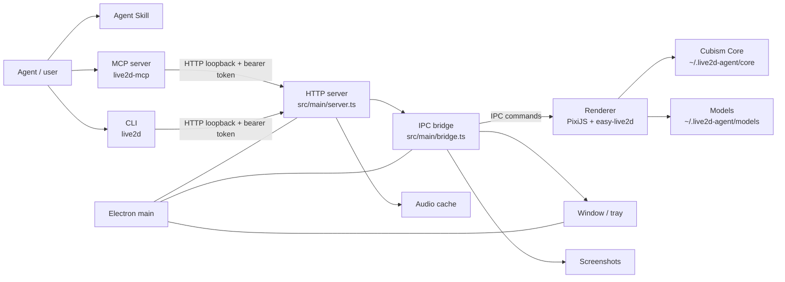

# Architecture

## Overview

Live2D Agent is a local Electron desktop companion with four cooperating
surfaces:

1. **Electron app** — a transparent, always-on-top pet window plus a tray icon.
   The main process owns the HTTP server, the window, the tray, screenshots and
   the IPC bridge. The renderer owns PixiJS/easy-live2d rendering, the bubble,
   TTS and pointer interaction.
2. **Local HTTP API** — loopback-only, token-authenticated. It is the single
   control surface used by everything else.
3. **CLI** (`live2d`) — a thin HTTP client that discovers the app through
   `runtime.json`, auto-starts it when needed, and formats human or JSON output.
4. **MCP server** (`live2d-mcp`) — a stdio MCP server exposing the same actions
   as tools for agent clients. It also auto-starts the app.

The Agent Skill (`skills/live2d-pet`) is documentation plus bundled CLI/MCP
scripts; it teaches an agent how to use the CLI safely.



## Processes and trust boundaries

| Process | Location | Responsibilities | Trust |
| --- | --- | --- | --- |
| Electron main | `src/main/` | App lifecycle, window, tray, HTTP server, IPC, screenshot, audio cache, model discovery, config persistence | Trusted |
| Preload | `src/preload/index.ts` | Narrow `contextBridge` API (`window.live2dBridge`) | Trusted bridge |
| Renderer | `src/renderer/` | PixiJS + easy-live2d, bubble, TTS, interaction, command handling | Sandboxed, no Node |
| CLI | `src/cli/index.ts` | HTTP client, auto-start, formatting, exit codes | Local client |
| MCP | `src/mcp/index.ts` | stdio MCP server, tool schemas, client lifecycle | Local client |

The renderer is loaded from the app's own HTTP server (or a dev Vite URL) with
`contextIsolation: true`, `sandbox: true` and `nodeIntegration: false`. IPC
senders are checked against the expected `webContents` and allowed origins.

## Startup sequence

1. `src/main/index.ts` takes a single-instance lock; a second launch just shows
   the existing window.
2. `app.whenReady()` → `ensureRuntimeDirsSync()` creates the runtime
   directories.
3. Config is loaded from `config.json` (with defaults merged and validated).
4. A random 32-byte token is generated for this run.
5. The bridge is created and IPC channels are attached.
6. The HTTP server binds `127.0.0.1` starting at `LIVE2D_PORT` or
   `config.server.port` (default 47100), trying up to 10 consecutive ports.
7. `runtime.json` is written atomically (base URL, port, token, pid, version,
   app root, Electron path, packaged flag), and `install.json` is refreshed.
8. The transparent window is created and loads the renderer from the local
   server (or `LIVE2D_DEV_URL` in dev mode).
9. The tray is created. The app stays alive when the window is hidden/closed;
   quit happens through the tray or `POST /api/v1/app/quit`.

The renderer calls `live2d:bootstrap` to receive the config, installed models,
the active model (id, display name, entry, optional model config), whether Core
exists and the Core URL. It loads Core from `/core/live2dcubismcore.min.js`,
loads the model from `/models/<id>/<entry>`, extracts capabilities, then sends
`renderer:ready`.

## Runtime directory

All mutable state lives outside the repository, by default under
`%USERPROFILE%\.live2d-agent\` (override with `LIVE2D_AGENT_HOME`):

```
.live2d-agent/
  core/live2dcubismcore.min.js   Cubism Core (user-provided, never bundled)
  models/<id>/                   Installed models (user-provided)
  logs/app.log                   JSON-lines log with rotation
  screenshots/                   PNG captures
  audio/                         Uploaded audio cache (10 min TTL)
  bin/                           live2d / live2d-mcp launchers
  runtime.json                   per-run discovery + token (0600, removed on quit)
  install.json                   app root + Electron path for auto-start
  config.json                    persisted window/render/behaviour/speech config
```

`src/shared/paths.ts` is the single source of truth for these paths and is
shared by the main process, CLI and MCP.

## Main-process modules

| Module | Role |
| --- | --- |
| `index.ts` | Lifecycle, token, server/window/tray wiring, runtime + install files, config debounce/quit. |
| `server.ts` | HTTP server: host/origin checks, bearer auth, rate limit, JSON/audio body limits, state/capabilities/commands/audio/quit routes, static renderer, Core, model and audio files. |
| `bridge.ts` | Command dispatch, pending request map with per-command timeouts, renderer state cache, screenshot prepare/done coordination, window drag. Handles model list/load, window set and screenshot capture in the main process; everything else is forwarded to the renderer. |
| `window.ts` | Frameless, transparent, always-on-top `BrowserWindow`; bounds clamping, drag/resize persistence, click-through, visibility, navigation/permission hardening, renderer crash handling. |
| `models.ts` | Model discovery, id/path validation, `model3.json` reference validation (relative, inside directory, existing), optional `live2d-agent.json` model config. |
| `screenshot.ts` | Prepares the renderer (render one frame), waits briefly, `capturePage()`, writes PNG, returns size/bytes. |
| `audio.ts` | Validates WAV/MP3/OGG uploads (magic bytes + MIME), 10 MB cap, UUID cache with 10-minute TTL. |
| `tray.ts` | Show/hide, always-on-top, click-through, reset, open models/logs folders, quit. |
| `tray-icon.ts` | Inline data-URL tray icon (no external assets). |

## Shared modules

| Module | Role |
| --- | --- |
| `protocol.ts` | Zod command schemas + `PublicState`, `Capabilities`, `CommandResponse`, `WindowState` types and empty-state defaults. |
| `config.ts` | App config and model config schemas, defaults, deep merge, validated read/write. |
| `client.ts` | `Live2DClient`: runtime discovery, health, auto-start, commands, audio upload, screenshot, stop, log tail. Clears `ELECTRON_RUN_AS_NODE` for the GUI child process. |
| `runtime.ts` | `runtime.json` / `install.json` read/write (atomic), process liveness. |
| `errors.ts` | Stable `ERROR_CODES`, `AgentError` with HTTP status mapping, payload conversion. |
| `paths.ts`, `log.ts`, `version.ts` | Runtime paths, JSON-lines logger, version constants. |

## Renderer modules

| Module | Role |
| --- | --- |
| `main.ts` | DOM/config setup, Core availability overlay, creates stage/Viewer/bubble/TTS, wires IPC. |
| `viewer.ts` | Command execution and state publication: expressions, motions, parameter overrides with TTL, gaze, transform, speech, bubble, reset, model load, screenshots; debounced `renderer:state`. |
| `live2d.ts` | PixiJS `Application` + easy-live2d sprite; Core version, capabilities extraction, parameter ranges, expression/motion control, lip-sync groups, hit detection, fit/scale/opacity. |
| `bubble.ts` | `textContent`-only speech bubble, truncation by code points, typewriter effect, TTL auto-hide. |
| `tts.ts` | `speechSynthesis` voice discovery (async voiceschanged), zh/en voice matching, approximate mouth envelope via LipSync parameters. |
| `interaction.ts` | Pointer drag → move window, hover gaze (throttled), tap → configured `hitActions` or `TapBody` fallback, drag suppression. |
| `errors.ts`, `types.ts` | Renderer error mapping/types. |

## Command flow

```
CLI/MCP ──HTTP POST /api/v1/commands──► server.ts
                                     │ auth, rate limit, zod validation
                                     ▼
                                 bridge.dispatch
             ┌───────────────────────┼─────────────────────────┐
             ▼                       ▼                         ▼
   main-process commands      screenshot.capture          renderer commands
   model.list/model.load      prepare/done + capturePage   IPC live2d:command
   window.set                 └────────────────────────────► renderer executes
                                                             │ renderer:result
             ◄───────────────────────────────────────────────┘
        response { v, id, ok, result, state }
```

- The bridge keeps a pending-command map keyed by UUID with a timeout. Timeouts
  return `TIMEOUT`; renderer disappearance returns `NOT_READY`.
- Renderer responses include the new public state. The bridge also accepts
  unsolicited `renderer:state` updates (the viewer debounces them to avoid IPC
  floods).
- `model.load` is special: the main process validates the model directory,
  sends an internal `model.load` payload (entry + model config) to the renderer,
  then persists the active id.
- `window.set` and `screenshot.capture` are handled without a renderer round
  trip (except screenshot prepare/done).

## Audio and speech flow

- `say --audio <file>`: CLI reads the file and POSTs it to `/api/v1/audio` with
  the detected MIME type. The main process validates the magic bytes and caches
  it by UUID. The CLI then sends `speech.say` with `audioUrl: /audio/<id>`; the
  renderer plays it through easy-live2d's voice playback and optional lip-sync.
- TTS stays entirely in the renderer: `speechSynthesis` with a system voice,
  while the viewer drives LipSync parameters to approximate mouth movement.
- Bubbles are rendered by the bubble module; `ttlMs` and auto-hide live in the
  renderer/bridge state.

## Configuration and persistence

- `config.json` stores window bounds/flags, render scale/opacity, behaviour
  (idle motion, gaze follow, blink, default expression), bubble styling/TTL,
  speech defaults and the active model id. Writes are debounced in the main
  process and atomic.
- `runtime.json` is per-run and removed on quit. A stale file is ignored when
  the pid is dead or `/health` fails.
- `install.json` is written by the app on start and by `npm run install:skill`;
  the CLI uses it (plus a repo-root fallback) to auto-start Electron.

## Build pipeline

| Command | Tool | Output |
| --- | --- | --- |
| `npm run build:renderer` | Vite | `dist/renderer/` |
| `npm run build:node` | esbuild | `dist/main.cjs`, `dist/preload.cjs`, `dist/cli.mjs`, `dist/mcp.mjs` |
| `npm run build:skill` | esbuild | `skills/live2d-pet/scripts/live2d.mjs`, `live2d-mcp.mjs` |
| `npm run build` | all of the above | complete runnable app + skill scripts |

`npm start` runs `scripts/start.mjs`, which removes an inherited
`ELECTRON_RUN_AS_NODE` before spawning Electron (a globally exported value would
otherwise make the GUI start as Node). `npm run dev` starts Vite on port 5173,
points Electron at `LIVE2D_DEV_URL`, and proxies `/core`, `/models` and
`/audio` to the app. Packaged installers are not configured in this version;
`install.json` is written with `packaged: false`.

## Failure handling

- Single-instance lock; second launch focuses the existing window.
- Renderer crash → bridge marks the page not ready and the window reloads after
  a short delay.
- Missing Core/model → renderer shows a setup overlay with the exact fix.
- Hidden window → screenshot returns `WINDOW_HIDDEN`.
- Stale runtime/install files are ignored or repaired on the next start.
- Uncaught main-process errors are logged; startup failures show a native error
  dialog and write the log.

See [protocol.md](protocol.md) for the wire formats, [security.md](security.md)
for the trust model and [manual-test.md](manual-test.md) for verification steps.
